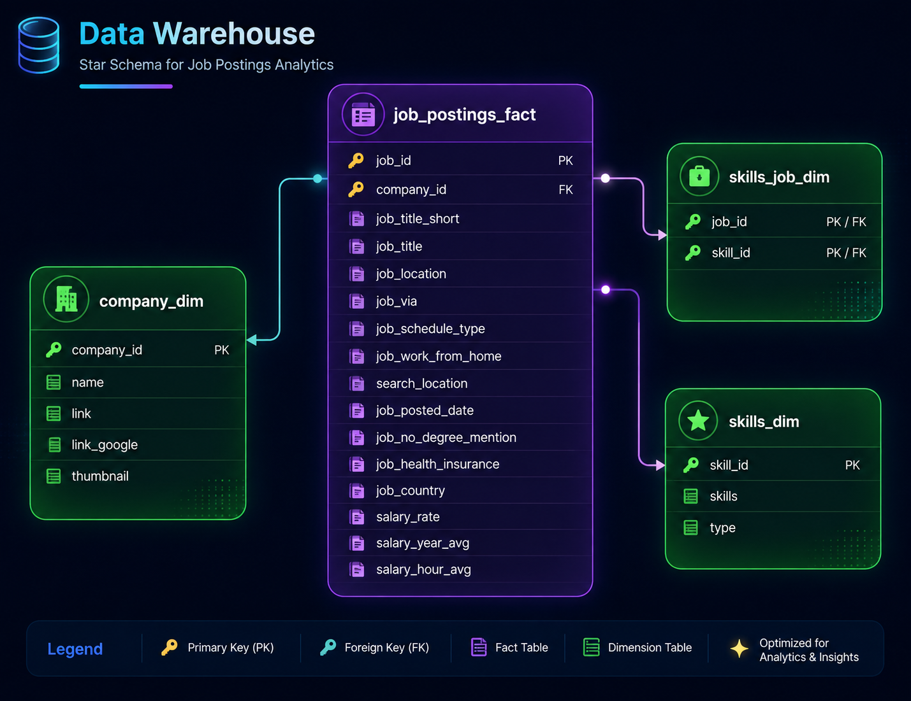

## 🔍 Exploratory Data Analysis w/ SQL: Job Market Analytics

  

A SQL project analyzing the data engineering job market using real-world job posting data. It showcases my ability **to write production-quality analytical SQL, optimize query performance, and transform complex business questions into actionable, data-driven insights.**  

# 🧾 Executive Summary (For Hiring Managers)  

- ✅ **Project Scope:** Designed and developed **three business-focused analytical SQL queries** to answer critical questions about the data engineering job market using real-world job posting data.  

- ✅ **Data Modeling & Query Design:** Leveraged **multi-table joins** across fact and dimension tables to integrate datasets and extract meaningful, high-quality insights.  

- ✅ **Advanced Analytics:** Utilized **aggregations, filtering, sorting, ranking, and statistical analysis** to identify the most in-demand skills, highest-paying technologies, and the optimal balance between demand and salary.  

- ✅ **Key Insights:** Generated **actionable, data-driven findings** highlighting SQL and Python's market dominance, emerging cloud technology trends, and compensation patterns to support informed career and hiring decisions.  

If you only have a minute, review these:

1. [01_top_demanded_skills.sql](/1_EDA/1_top_demanded_skills.sql) – demand analysis with multi-table joins  

2. [02_top_paying_skills.sql](/1_EDA/2_top_paying_skills.sql) – salary analysis with aggregations  

3. [03_optimal_skills.sql](/1_EDA/3_optimal_skills.sql) – combined demand/salary optimization query  

# 🧩Problem & Context  

Organizations, recruiters, and aspiring data engineers often need answers to key labor market questions, such as:

- 🎯 High-Demand Skills: Which technical skills are most sought after by employers hiring data engineers?  

- 💰 Top-Paying Skills: Which skills are associated with the highest median salaries?  

- ⚖️ Optimal Skill Investment: Which skills provide the best balance between market demand and earning potential?  

To answer these questions, this project performs an in-depth analysis of **real-world data engineering job postings using a star schema data warehouse.** By leveraging production-style SQL queries across fact and dimension tables, the analysis uncovers meaningful labor market trends and actionable insights for job seekers, recruiters, and hiring managers.

The underlying data warehouse follows a **star schema** architecture consisting of:  

  

- **Fact Table:** `job_postings_fact` — the core table holding job posting attributes (title, location, salary, date posted, etc.)  

- **Dimension Tables:**
  - `company_dim`  — employer details tied to each posting  

  - `skills_dim` — catalog of skills, including names and categories  

- **Bridge Table:** `skills_job_dim` — links postings to skills, handling the many-to-many relationship between them

Querying across these related tables surfaced insights into skill demand, salary trends, and the most effective skill combinations for data engineering roles.  

# 🧰 Tech Stack  

- **🐤 Query Engine:** DuckDB for fast OLAP-style analytical queries  

- **🧮 Language:** SQL (ANSI-style with analytical functions)  

- **📊 Data Model:** Star schema with fact + dimension + bridge tables  

- **🛠️ Development:** VS Code for SQL editing + Terminal for DuckDB CLI  

- **📦 Version Control:** Git/GitHub for versioned SQL scripts  


# 📂 Repository Structure  

``` 
1_EDA/
├── 01_top_demanded_skills.sql    # Demand analysis query
├── 02_top_paying_skills.sql      # Salary analysis query
├── 03_optimal_skills.sql         # Combined demand/salary optimization
└── README.md                     # You are here  
```  
# 🏗 Analysis Overview  

**📂 Query Breakdown**

This project consists of three analytical SQL queries, each designed to answer a key business question about the data engineering job market.

1. [**Top Demanded Skills**](/1_EDA/1_top_demanded_skills.sql) – Identifies the 10 most in-demand technical skills for data engineering roles by analyzing job posting frequency.  

2. [**Top Paying Skills**](/1_EDA/2_top_paying_skills.sql) – Evaluates the highest-paying skills by comparing median salaries alongside market demand.  

3. [**Optimal Skills**](/1_EDA/3_optimal_skills.sql) – Ranks skills using a composite score that combines the natural logarithm of demand with median salary, highlighting technologies that offer the strongest balance between employability and earning potential.  

**📈 Key Insights**  

- 🧠 Programming Fundamentals: SQL and Python dominate the market, each appearing in approximately 29,000 job postings, making them the two most sought-after skills. 

- ☁️ Cloud Expertise: Cloud platforms such as AWS and Azure have become essential competencies for modern data engineering roles. 

- 🏗️ Infrastructure & DevOps: Technologies including Kubernetes, Docker, and Terraform are consistently associated with premium salaries, reflecting the growing demand for infrastructure automation skills.

- 🔥 Big Data Ecosystem: Apache Spark demonstrates a strong combination of high employer demand and competitive compensation, reinforcing its importance in large-scale data processing.  

# 💻 SQL Skills Demonstrated  

**Query Design & Optimization**  

- **Complex Joins:**  Multi-table `INNER JOIN` operations across `job_postings_fact`, `skills_job_dim`, and `skills_dim`  

- **Aggregations:** `COUNT()`, `MEDIAN()`, `ROUND()` for statistical analysis  

- **Filtering:** Boolean logic with `WHERE` clauses and multiple conditions (`job_title_short`, `job_work_from_home`, `salary_year_avg IS NOT NULL`)  

- **Sorting & Limiting:** `ORDER BY` with `DESC` and `LIMIT` for top-N analysis  

**Data Analysis Techniques**  

- **Grouping:** `GROUP BY` for categorical analysis by skill

- **Mathematical Functions:** `LN()` for natural logarithm transformation to normalize demand metrics

- **Calculated Metrics:** Derived optimal score combining log-transformed demand with median salary

- **HAVING Clause:** Filtering aggregated results (skills with >= 100 postings)

- **NULL Handling:** Proper filtering of incomplete records (`salary_year_avg IS NOT NULL`)


