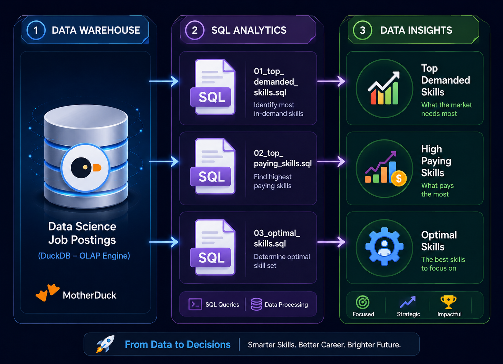

# SQL Data Engineering Projects  

The following projects are a collection of SQL projects that I have worked on to practice and reinforce my  skills with data engineering tools.  

> Click the project name below to view the tools I used to build these!  

## Projects  
  
### [1. EDA](/1_EDA/) - Exploratory Data Analysis  

    

SQL -driven analysis of data engineer job market trends using advanced querying tecniques.  

